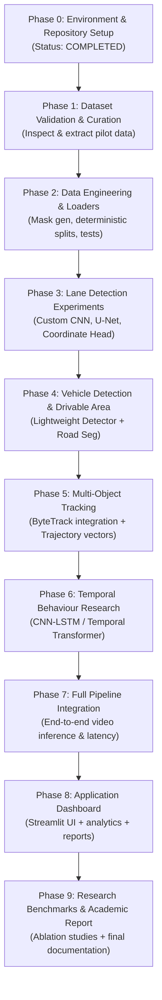

# Traffic Intelligence AI: Master Phase-by-Phase Development Roadmap

**Project:** Traffic Intelligence AI  
**Repository:** [https://github.com/Max-i26/Traffic-Analysis](https://github.com/Max-i26/Traffic-Analysis)  
**Target Hardware:** NVIDIA GeForce RTX 2050 (4 GB VRAM) | Windows 11  

---

## Roadmap Overview & Approval Gates

---

## Detailed Phase Breakdown & User Instructions

### Phase 0: Environment, Hardware & Repository Audit (Current Phase)
- **Status:** **Completed**
- **Deliverables:**
  - Git initialized and linked to `https://github.com/Max-i26/Traffic-Analysis.git`.
  - `.gitignore` configured to safeguard raw datasets and weights.
  - `docs/environment_report.md` created.
  - `docs/dataset_inventory.md` created.
  - `docs/dataset_quality_report.md` created.
  - `docs/development_roadmap.md` created.
- **Instruction to User:** Review the audit findings. Approve moving to Phase 1.

---

### Phase 1: Dataset Validation & Pilot Extraction
- **Objective:** Safely extract and validate TuSimple annotations and masks without exhausting disk space.
- **Tasks:**
  1. Set up project folder structure (`configs/`, `datasets/`, `src/`, `tests/`, `checkpoints/`).
  2. Extract TuSimple training JSONs and a curated subset of 200 keyframes + masks for rapid visual inspection.
  3. Build an automated verification script `src/data/dataset_audit.py` to check for missing files, corrupt images, and label alignment.
  4. Generate visual overlay samples (Raw Image + Lane Lines + Seg Mask).
- **Approval Gate 1:** User reviews dataset verification report and sample overlays before pipeline construction.

---

### Phase 2: Data Engineering & PyTorch DataLoaders
- **Objective:** Build robust, leak-free PyTorch datasets and augmentations.
- **Tasks:**
  1. Implement `src/data/annotation_parser.py` (parse JSON coordinate sequences and handle `-2` missing values).
  2. Implement coordinate-to-mask rasterizer and verify against `seg_label`.
  3. Create deterministic, leakage-safe train/val/test splits partitioned by video clip (not random frames).
  4. Write unit tests in `tests/test_dataset_loaders.py`.
- **Approval Gate 2:** All unit tests pass; dataloaders yield correct tensor shapes (`[B, C, H, W]`).

---

### Phase 3: Lane Detection Model Experiments (Module A)
- **Objective:** Design, train, and compare custom neural network architectures.
- **Models to Build:**
  - **Model A1:** Custom lightweight CNN Lane Segmentation Network.
  - **Model A2:** Custom U-Net with skip connections.
  - **Model A3:** Coordinate-based direct lane regression head.
- **Optimization Strategy:**
  - Resolution: 512 × 288.
  - Batch size: 4 with FP16 Automatic Mixed Precision (AMP).
  - Loss: Combined Dice Loss + Binary Cross-Entropy (BCE).
  - Validation metrics: IoU, Dice, Precision, Recall, Inference FPS.
- **Approval Gate 3:** Review comparative benchmark table and visual segmentation results before moving to vehicle detection.

---

### Phase 4: Vehicle Detection & Road Segmentation (Modules B & C)
- **Objective:** Train lightweight road drivable area segmentation and vehicle detection.
- **Tasks:**
  1. Road segmentation using BDD100K drivable maps (70k train, 10k val) with custom lightweight encoder-decoder.
  2. Ingest BDD100K bounding box annotations for vehicle detection (Car, Bus, Truck, Motorcycle).
  3. Compare custom model performance vs. standard baselines.
- **Approval Gate 4:** Review detection mAP@0.5 and drivable area mIoU.

---

### Phase 5: Multi-Object Tracking & Trajectory Extraction (Module D)
- **Objective:** Track vehicles across consecutive frames and extract motion trajectories.
- **Tasks:**
  1. Integrate ByteTrack / Kalman Filter tracking head.
  2. Associate vehicle trajectories with lane boundaries (which lane each vehicle occupies).
  3. Calculate pixel displacement, motion vectors, and smoothed trajectories.
- **Approval Gate 5:** Review tracking accuracy, ID switches, and trajectory overlays on video clips.

---

### Phase 6: Temporal Behaviour & Violation Analysis (Module E)
- **Objective:** Classify traffic events and potential violations over time windows.
- **Tasks:**
  1. Model E1: CNN-LSTM temporal sequence classifier.
  2. Model E2: Lightweight Temporal Transformer over 16-frame trajectory tokens.
  3. Implement explicit rule-based validation (lane departure, wrong-way vector against lane flow, stop-line crossing).
- **Approval Gate 6:** Evaluate F1-score, event precision/recall, and false-positive rates.

---

### Phase 7: Full Pipeline Integration
- **Objective:** Connect all individual modules into a unified, modular video inference pipeline.
- **Tasks:**
  1. End-to-end inference script: Video input → Frame Extraction → Lane & Vehicle Detection → Tracking → Temporal Analysis → Visual Overlay.
  2. Latency benchmarking on RTX 2050 (target real-time / near-real-time throughput).
- **Approval Gate 7:** Verify pipeline runs end-to-end on test video clips without memory leaks.

---

### Phase 8: Traffic Intelligence Application (Module F)
- **Objective:** Deploy an interactive, professional web application.
- **Tasks:**
  1. Streamlit dashboard with video upload, real-time visual playback, per-lane vehicle HUD, and violation event logs.
  2. Exportable PDF / CSV incident reports.
- **Approval Gate 8:** Application demonstration review.

---

### Phase 9: Research Documentation & Academic Report
- **Objective:** Complete reproducible research artifacts, comparative ablation studies, and comprehensive final documentation.
- **Tasks:**
  1. Full academic report with methodology, formulas, ablation tables, and error analyses.
  2. Clean GitHub repository release with instructions and documentation.
